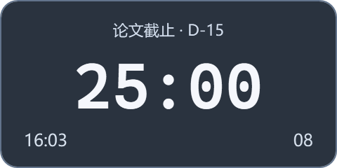
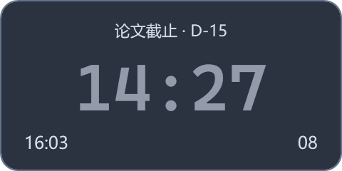
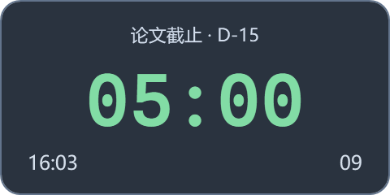
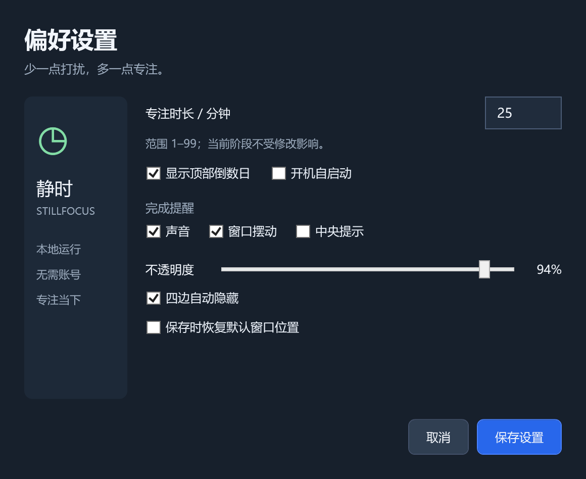
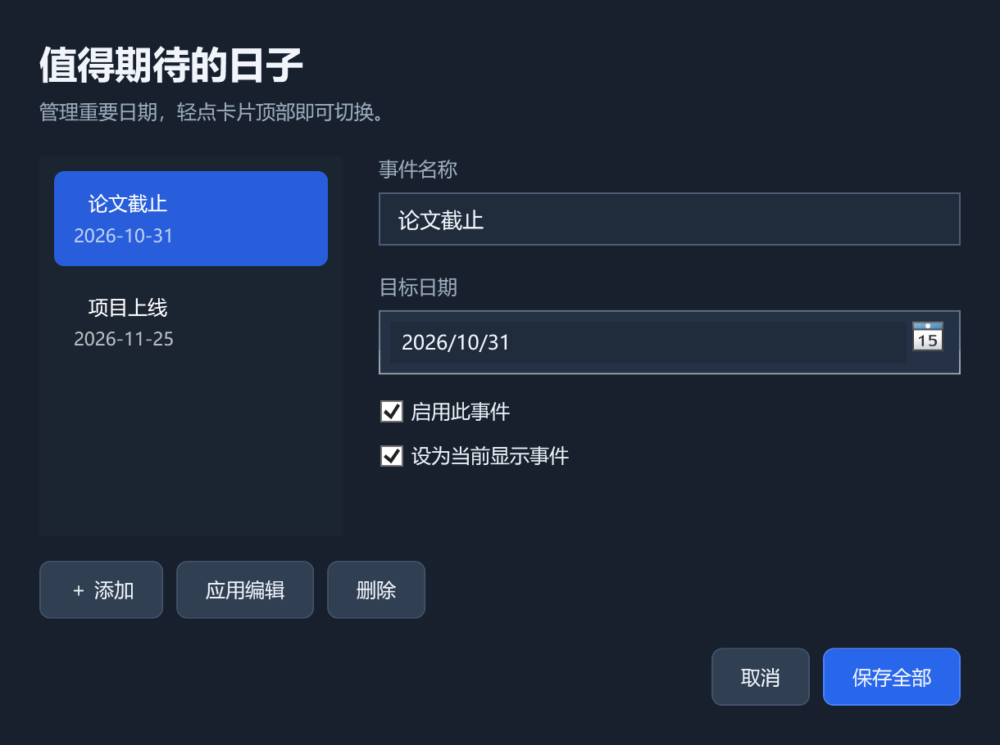

<div align="center">

# 静时 · StillFocus

**把注意力留给当下。**

极简 Windows 桌面悬浮番茄钟 · 轻量倒数日 · 本地运行


[下载 Windows 版](https://github.com/happy-fuckingday/still-focus/releases/latest) · [更新记录](CHANGELOG.md) · [验收清单](docs/ACCEPTANCE.md)

</div>

## 简介

静时将四项信息放进一张约 **240 × 120 逻辑像素**的桌面卡片：重要日期、当前倒计时、系统时间、累计完成次数。按钮隐藏在鼠标交互、右键菜单和系统托盘中。没有启用的倒数日时，卡片自动缩小为约 240 × 98。

作者：**Codex**。项目采用 MIT 许可证。

## 下载与运行

1. 在 [Releases](https://github.com/happy-fuckingday/still-focus/releases) 下载 `StillFocus-1.0.0-win-x64.zip`。
2. 解压到固定的可写目录，双击 `StillFocus.exe`。
3. 在卡片主时间上单击开始计时；右键打开菜单。

适用 Windows 10 / 11 **64 位**。发行包自带 .NET 运行时，无需安装 Python、.NET SDK 或其他开发环境。无需管理员权限。

程序使用系统托盘，主卡片不占任务栏。找不到卡片时，打开托盘菜单选择“显示主窗口”，或再次双击程序。也可运行 `StillFocus.exe --settings` 直接打开设置。退出请使用右键菜单或托盘菜单的“退出”。

首版未进行商业代码签名，Windows 可能显示发布者未知；请仅从本仓库下载并核对发行页的 SHA-256。

## 功能

| 模块 | V1.0 行为 |
|---|---|
| 专注计时 | 默认 25 分钟，可设为 1–99 分钟；单击开始、暂停、继续 |
| 自动休息 | 专注正常完成后自动开始固定 5 分钟休息；结束或跳过后停在 00:00 |
| 阶段重置 | 双击恢复当前阶段初始时长并暂停；不增加次数 |
| 完成次数 | 跨天累计，00–99 循环；支持确认后清零 |
| 倒数日 | 多事件添加、编辑、删除、启用、选择；顶部单击轮换 |
| 四边隐藏 | 拖到屏幕工作区边缘释放后停靠，保留约 6 逻辑像素触发条 |
| 完成提醒 | 声音、轻微摆动、3 秒中央提示可分别开关；中央提示默认关闭 |
| 窗口设置 | 默认置顶、不透明度 40%–100%、恢复位置、高 DPI 支持 |
| 系统集成 | 系统托盘、单实例、可选开机启动（默认关闭） |
| 本地保存 | 原子写入及上一版备份；不含账号、联网请求、遥测或云同步 |

## 界面与状态

以下图片由实际 WPF 界面渲染，使用虚构事件与测试计数；设置和管理窗口展示客户区。

| 专注待机 | 暂停 | 自动休息 |
|---|---|---|
|  |  |  |





主卡片自上而下显示倒数日、主倒计时，底部两端显示当前时间和完成次数。长事件名称省略显示，悬停可查看全名和日期。

| 状态 | 倒计时颜色 | 后续操作 |
|---|---|---|
| 未开始 / 专注中 | 白色 | 单击开始 / 暂停 |
| 专注或休息已暂停 | 灰色 | 单击继续 |
| 休息中 | 浅绿色 | 单击暂停，或菜单跳过 |
| 休息结束 | 白色 `00:00` | 单击开始下一轮专注 |

设置窗口统一管理时长、提醒、倒数日显示、不透明度和自动隐藏。倒数日管理窗口左侧选择事件，右侧编辑名称和日期；“保存全部”提交本次修改，“取消”放弃本次修改。

## 操作说明

| 操作 | 结果 |
|---|---|
| 单击主时间 | 开始 / 暂停 / 继续 |
| 双击主时间 | 重置本阶段并暂停 |
| 滚轮向上 / 向下 | 仅未开始专注时，时长 +1 / −1 分钟 |
| 单击顶部事件 | 轮换下一个启用的倒数日 |
| 拖动卡片空白处 | 移动窗口；靠近四边释放可停靠 |
| 右键卡片 | 计时、事件、提醒、窗口、清零、启动及退出菜单 |
| 鼠标移入触发条 | 约 150 ms 后展开；离开约 500 ms 后收起 |
| 卡片有键盘焦点时按空格 | 开始 / 暂停 / 继续 |
| 托盘双击 / 显示主窗口 | 解除停靠并找回卡片 |

单击需要等待 Windows 的双击判定间隔，以避免双击同时触发一次开始或暂停。主时间不能用于拖动；请拖动边距或底部空白处。

### 计时规则

- 使用 `Stopwatch` 单调时间基准，按照实际经过时间计算，不采用逐秒递减；系统时钟修改不会改变剩余时长。
- 本轮开始后，即使暂停，滚轮也不会修改本轮。设置中的新时长从下一轮生效；双击重置使用本轮开始时的时长。
- 专注结束只计数一次，并自动进入休息；休息结束后等待手动开始下一轮。
- 锁屏、断开会话、睡眠和唤醒后保持暂停，等待手动继续。
- 退出或异常结束后，重新打开回到完整专注待机；不恢复未完成计时，不补算离线次数。

### 倒数日规则

按 Windows **本地日历日期**计算，未来显示 `D-15`，当天显示“今天”，过去显示“已过 3 天”。日期持续重新计算，跨零点和系统日期变化后自动更新。事件不会自动删除，也不会触发闹钟。

### 贴边与全屏

只有用户拖至边缘并释放才启用停靠。菜单或设置打开期间不自动收起，隐藏时仍正常计时；完成时不强制展开。

触发条保留在当前显示器的工作区内，通过裁切窗口避免跨屏接缝泄漏。显示器变化后重新约束位置。全屏避让使用前台窗口几何检测，对多数独占或无边框全屏应用隐藏卡片和中央提示，退出全屏后恢复。不同 DPI、多屏热插拔和特定游戏仍需按[验收清单](docs/ACCEPTANCE.md)在目标设备实测。

## 数据与隐私

本地配置：`%LOCALAPPDATA%\StillFocus\settings.json`，备份为 `settings.json.bak`。保存时先写入临时文件并刷新磁盘，再原子替换；主配置损坏时尝试从备份恢复。

配置包含时长、次数、事件、提醒与窗口设置。**发行包和源码仓库不包含本机配置、真实事件、使用记录或凭据。** 应用不自动收集或上传数据。

开机启动启用时，只向当前用户的 `HKCU\Software\Microsoft\Windows\CurrentVersion\Run` 写入 `StillFocus` 项。移动程序后，请关闭并重新启用开机启动以更新路径。删除软件前可先取消开机启动；需要清除配置时再手动删除上述本地目录。

## 源码与构建

开发环境：Windows x64、.NET **10 SDK**、PowerShell 7。应用代码不依赖第三方 NuGet 包。

```powershell
dotnet build src/StillFocus.App -c Release
dotnet run --project tests/StillFocus.Tests -c Release
dotnet run --project src/StillFocus.App
```

生成自包含发行包：

```powershell
pwsh ./tools/publish.ps1
```

产物在 `artifacts/`，包含便携 ZIP 与 SHA-256。构建脚本先运行核心测试，再发布 Windows x64 单文件。GitHub Actions 在推送和 Pull Request 时构建并保存产物。

```text
src/StillFocus.Core/     单调计时状态机、日历日期及可靠持久化
src/StillFocus.App/      WPF 界面、托盘、系统事件及四边停靠
tests/StillFocus.Tests/  无第三方测试框架的确定性核心测试
tests/StillFocus.VisualTests/ WPF 窗口创建与预览渲染测试
tools/                  发行脚本、原创图标及提示音生成器
docs/                   界面截图与验收说明
```

图标为原创几何时钟，提示音为本项目生成的双音，无第三方素材。可选执行 `python tools/generate-assets.py` 重新生成；常规构建直接使用仓库内的资源文件。

## 验证与版本维护

V1.0 核心 **13 项自动化测试通过**，覆盖阶段转换、暂停恢复、重置、计数循环、99 分钟边界、日期计算、备份恢复和异常值修正。硬件与系统交互的验证范围、步骤及限制见 [ACCEPTANCE.md](docs/ACCEPTANCE.md)。

可在具有交互桌面的 Windows 上执行 `dotnet run --project tests/StillFocus.VisualTests -c Release -- artifacts/visual` 进行窗口创建及渲染冒烟测试；测试使用隔离的临时配置，不读取真实日程。托管 CI 仅执行核心测试和发行构建。桌面捕获工具未能正确捕获此环境中的窗口画面，故仓库预览采用程序渲染，不作为实际鼠标交互验收的证明。

提交问题时请描述系统版本、缩放比例、复现步骤、预期和实际行为；不要上传包含个人日程的配置或未脱敏截图。

每次正式更新在 [CHANGELOG.md](CHANGELOG.md) 记录日期、新增、修复与兼容性说明。首版不包含自动更新、历史统计、云同步、任务清单和复杂日历。

## 许可

[MIT License](LICENSE) · Copyright © 2026 Codex

发行包内置的 Microsoft .NET 运行时遵循其各自许可，原始许可和第三方声明随包附在 `licenses/` 中。
